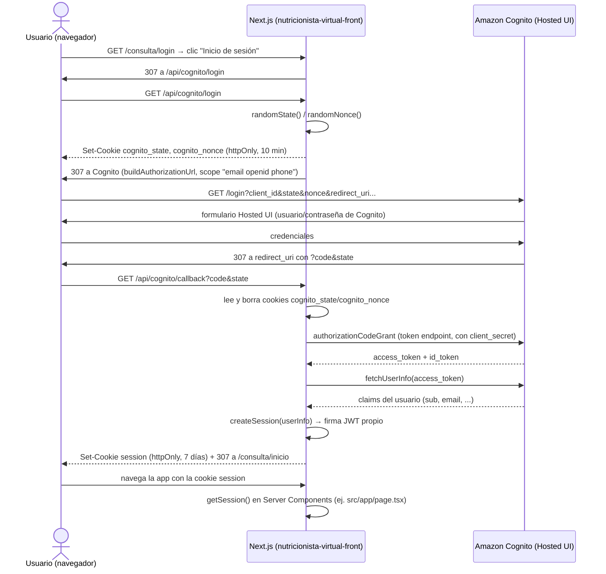
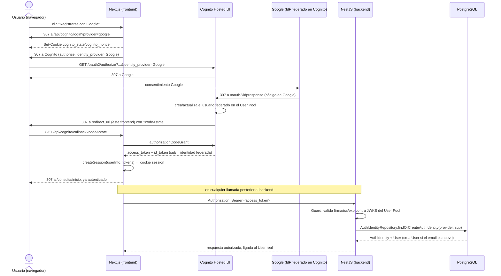

# Flujo de autenticación: frontend, Cognito, Google, backend NestJS y la DB

> **Nota sobre esta versión**: la versión anterior de este documento se escribió sin acceso al
> repo del backend (`nutricionista-virtual-back`) ni a `prisma/schema.prisma`, así que todo lo
> relativo a "cómo debería encajar el backend" era especulación desde afuera. Esta versión sí leyó
> ese repo (código + `CLAUDE.md` + `doc/`) y el de la base de datos (`nutricionista-virtual-db`), y
> corrige varias cosas: el backend **ya tiene** un modelo de dominio `User`/`AuthIdentity` pensado
> explícitamente para Cognito + Google, pero no está conectado a ningún endpoint; y ya existe una
> segunda vía, independiente de Cognito, que crea filas `User` en Postgres (al generar una orden).

## 0. Mapa de piezas — qué existe hoy y dónde

| Pieza | Estado | Dónde |
|---|---|---|
| Login/logout contra Cognito Hosted UI (usuario/contraseña nativo) | **Implementado** | `nutricionista-virtual-front/src/app/api/cognito/{login,callback,logout}/route.ts` |
| Sesión propia del frontend (cookie `session`, JWT HMAC) | **Implementado** | `nutricionista-virtual-front/src/shared/auth/session.ts` |
| Google como Identity Provider en el User Pool de Cognito | **No existe** | Configuración AWS (Cognito Console), fuera de ambos repos |
| Botón/parámetro para pedir el proveedor Google en la Hosted UI | **No existe** | Tendría que ir en `src/app/api/cognito/login/route.ts` |
| Modelo de dominio `User` / `AuthIdentity` (provider `COGNITO`\|`GOOGLE`) | **Construido, no conectado** | `nutricionista-virtual-back/prisma/schema.prisma`, `src/domain/{entities,dtos,datasources,repositories}/identity-auth/**`, `src/infrastructure/{datasources,repositories}/identity-auth/**` |
| Endpoint backend que reciba el token de Cognito y cree/actualice `AuthIdentity` | **No existe** | Tendría que ir en un nuevo `presentation/auth/` (no existe hoy) |
| Guard/middleware que valide el JWT (JWKS) en rutas del backend | **No existe** | Cero paquetes (`passport-jwt`, `aws-jwt-verify`, `jwks-rsa`) instalados en `package.json` del backend |
| Creación de `User` en Postgres **sin pasar por Cognito** | **Implementado, es la única vía real hoy** | `OrdersService.createOrder` → `UserRepository.findOrCreateUserByEmail` |
| Vínculo entre la sesión Cognito del frontend y un `User`/`AuthIdentity` del backend | **No existe** | — |

En una frase: **hoy hay dos sistemas de identidad que no se hablan**. Cognito autentica al
frontend (ve un `sub`, un `email`, un `id_token`). Postgres, por otro lado, ya tiene una tabla
`user` — pero las filas que existen hoy se crearon **al pagar una consulta**, por email, sin que
nadie haya iniciado sesión nunca.

## 1. Flujo implementado hoy (frontend ↔ Cognito, usuario/contraseña nativo)



Logout: `GET /api/cognito/logout` borra la cookie `session` y redirige al `/logout` propietario del
Hosted UI de Cognito (no es RP-Initiated Logout estándar — ver `doc/auth.md`).

Notas importantes sobre este flujo tal como está implementado, porque difieren de lo recomendado en
`doc/architecture/deployment-architecture.md` (sección 6) y `doc/security/deployment-security.md`
(sección 2) del repo raíz:

- El App Client de Cognito usado hoy es **confidencial** (tiene `client_secret`, usado en
  `authorizationCodeGrant`). El doc de arquitectura recomienda un **cliente público sin secret +
  PKCE**, que es lo estándar para una SPA. Como el intercambio de código ocurre en un Route Handler
  server-side (no en el navegador), usar un cliente confidencial es defendible, pero es una
  decisión que vale la pena confirmar explícitamente si algún día el flujo se mueve al navegador
  (ej. Amplify Auth client-side).
- **No se usa PKCE** (solo `state` + `nonce`). Igual de válido dado que el intercambio es
  server-to-server, pero es otra divergencia respecto al doc de arquitectura.
- La sesión que ve el resto de la app (`session`, cookie HMAC propia del frontend) **no es** el
  `id_token`/`access_token` de Cognito — es un JWT propio firmado con `SESSION_SECRET`, que el
  backend NestJS no conoce ni puede validar. Esto es clave para la sección 2: el backend no tiene
  ninguna forma de saber, hoy, que un usuario inició sesión.

**Ningún paso de este flujo toca al backend NestJS ni a la base de datos.** Todo el intercambio de
tokens pasa por Route Handlers de este frontend hablando directo con Cognito.

## 2. Lo que el backend ya construyó para esto — y que nadie conecta todavía

A diferencia de lo que asumía la versión anterior de este documento, el backend **no es una caja
negra sin auth**: tiene un modelo de dominio completo, listo para Cognito *y* Google, construido
en la migración documentada en `nutricionista-virtual-back/doc/postgres-domain-groundwork.md`. Lo
que falta es puramente la capa `presentation/` (controlador + guard) que lo active.

### 2.1 El schema ya modela multi-proveedor (`COGNITO` | `GOOGLE`)

`nutricionista-virtual-back/prisma/schema.prisma`, sección `IDENTITY & AUTH`:

```prisma
model User {
  id String @id @default(dbgenerated("gen_random_uuid()")) @db.Uuid
  rut, rutCheckDigit, email (unique, nullable)
  firstName, middleName, paternalLastName, maternalLastName, gender, dateOfBirth, photoUrl
  authIdentities  AuthIdentity[]
  clinicalRecord, nutritionalConsultations, orders
}

model AuthIdentity {
  id String @id @default(dbgenerated("gen_random_uuid()")) @db.Uuid
  userId String @db.Uuid
  provider String        // "COGNITO" | "GOOGLE" — sin enum nativo en Postgres, tipado en la app
  providerUserId String   // el `sub` que entrega Cognito (nativo o federado a través de Google)
  email String
  emailVerified Boolean
  isPrimary Boolean
  createdAt DateTime
  @@unique([provider, providerUserId])
}
```

Es decir: **un `User` puede tener varias `AuthIdentity`** (por ejemplo, uno que inició sesión con
usuario/contraseña de Cognito y luego también vinculó Google) y el `@@unique([provider,
providerUserId])` es exactamente lo necesario para resolver "dado un `sub` de Cognito, ¿qué
usuario es". `src/domain/entities/user.entity.ts` (línea 11) declara el tipo TypeScript
`AuthProvider = 'COGNITO' | 'GOOGLE'` a partir de este mismo campo.

Cuando el objetivo final es "clic en registro → Google → registrado", el diseño esperable es que
Google **no** aparezca como un tercer valor a mano — Cognito ya lo modela como *federated identity
provider dentro del mismo User Pool*: el usuario elige "Continuar con Google" en la Hosted UI,
Cognito hace el intercambio con Google por detrás, y a este backend le sigue llegando un `id_token`
de Cognito cuyo `sub` es estable — solo que ese `sub` corresponde a una identidad federada en vez de
nativa. `provider: 'GOOGLE'` en `AuthIdentity` sirve para que el backend sepa distinguir *cómo* se
autenticó ese `sub`, no para hablar con Google directamente.

### 2.2 Las cuatro capas ya existen — pero terminan en el vacío

`src/domain/datasources/identity-auth/{user,auth-identity}.datasource.ts` →
`src/domain/repositories/identity-auth/{user,auth-identity}.repository.ts` →
`src/infrastructure/datasources/identity-auth/{user,auth-identity}.datasource.ts` (implementación
Prisma) → `src/infrastructure/repositories/identity-auth/{user,auth-identity}.repository.ts`
(delegación) → `IdentityAuthDatasourcesModule` / `IdentityAuthRepositoriesModule`, ambos
registrados en `app.module.ts`.

`AuthIdentityRepository` (inyectable, ya registrado en el módulo) expone hoy:

```ts
createAuthIdentity(dto): Promise<AuthIdentityEntity>
getAuthIdentityById(id): Promise<AuthIdentityEntity | null>
updateAuthIdentityById(id, dto): Promise<AuthIdentityEntity>
deleteAuthIdentityById(id): Promise<void>
```

**Ningún módulo de `presentation/` lo inyecta.** Un `grep` de `AuthIdentityRepository` en
`src/presentation/**` no devuelve resultados: es la única de las 12 entidades con
datasource/repository construidos que no tiene ni un solo consumidor real (el resto —
`ClinicalRecord`, `Order`, `Product`, etc. — sí se usa vía `OrdersService`/`ConsultationService`).

**Gap concreto a tener en cuenta al implementar el login real**: falta el método más obvio para un
login — "dado `provider` + `providerUserId`, devuélveme (o créame) el `AuthIdentity`/`User`
correspondiente". Hoy solo existe `getAuthIdentityById(id)` (por PK propia, no por `provider` +
`sub`), a pesar de que el `@@unique([provider, providerUserId])` del schema está pensado
exactamente para esa consulta. Habría que agregar algo como `findByProviderAndProviderUserId` (o
un `findOrCreateAuthIdentity`, simétrico al `findOrCreateUserByEmail` que ya existe en
`UserDatasource`) antes de poder escribir el endpoint de login.

### 2.3 Variables de entorno que **no** son de esto (trampa a evitar)

`nutricionista-virtual-back/.env.template` tiene `JWT_ACCESS_SECRET`, `JWT_REFRESH_SECRET`,
`JWT_ACCESS_EXPIRATION`, `JWT_REFRESH_EXPIRATION`, `BCRYPT_SALT_OR_ROUNDS`. Son **restos de un
módulo de auth local (usuario/contraseña propio con bcrypt) que fue removido** — así lo dice
`nutricionista-virtual-back/CLAUDE.md` explícitamente. No tienen relación con `User`/`AuthIdentity`
ni con Cognito. Si se implementa la validación de JWT de Cognito, es contra el JWKS público del
User Pool (no contra `JWT_ACCESS_SECRET`, que serviría para *emitir* tokens propios, algo que este
diseño no necesita porque Cognito ya los emite). Vale la pena limpiar estas variables o
reutilizarlas explícitamente, para no confundir a alguien que lea el `.env.template` pensando que
ya hay JWT propio funcionando.

## 3. La isla paralela que sí toca la DB hoy: `User` se crea al pagar, no al iniciar sesión

`OrdersService.createOrder` (`nutricionista-virtual-back/src/presentation/orders/orders.service.ts`,
línea 54) es la **única** ruta de código hoy que escribe en la tabla `user`:

```ts
const user = await this.userRepository.findOrCreateUserByEmail({
  email: personalInfo.email,
  rut, rutCheckDigit, firstName, middleName, paternalLastName, maternalLastName,
  gender, dateOfBirth,
});
```

Esto pasa cuando el usuario llega a "Generar orden" al final del flujo de consulta
(`/consulta/generar-orden`), usando el email que escribió en el formulario de información
personal — **nunca** el email de su sesión de Cognito, porque hoy nada conecta ambos. Si el email
ya existe, se reutiliza ese `User` tal cual (sin actualizar sus datos); si no, se crea uno nuevo.
No se crea ninguna fila `AuthIdentity` en este flujo — este `User` no queda vinculado a ningún
proveedor de identidad, solo tiene un email.

**Consecuencia a tener presente para el diseño del login real**: cuando se conecte Cognito/Google
al backend, el `findOrCreateAuthIdentity` del punto 2.2 tiene que **resolver contra emails que ya
pueden existir en `user`** (alguien pagó una consulta con `ana@example.com` sin loguearse nunca, y
después esa misma persona se registra con Google usando `ana@example.com`). La estrategia más
simple es que ese `findOrCreateAuthIdentity` primero busque `User` por email (igual que
`findOrCreateUserByEmail` ya hace) antes de decidir si crea un `User` nuevo — para no terminar con
dos filas `user` duplicadas para la misma persona.

## 4. Lo que falta para "clic en Registro → Google → registrado"

Son tres piezas independientes, en tres lugares distintos, y **ninguna existe hoy**:

### 4.1 AWS — Google como Identity Provider federado en el User Pool (fuera de ambos repos)

1. Crear credenciales OAuth 2.0 ("ID de cliente de OAuth" tipo *Web application*) en Google Cloud
   Console, con el *redirect URI* que exige Cognito para IdPs federados
   (`https://<dominio-cognito>/oauth2/idpresponse`).
2. En el User Pool de Cognito → **Sign-in experience → Federated identity provider sign-in** →
   agregar **Google**, con el Client ID/Secret del paso anterior y los scopes
   `profile email openid`.
3. Mapear atributos del IdP a atributos del User Pool (mínimo: `email` → `email`, `sub` de Google
   → el identificador que Cognito expone como `sub` de la identidad federada).
4. En el App Client usado por este frontend, habilitar **Google** en "Identity providers"
   (junto a "Cognito user pool", que ya debe estar habilitado — es el que se usa hoy).
5. Repetir para cada ambiente (dev/prod) si los User Pools son distintos.

Esto es configuración de infraestructura, no requiere cambios en ningún repo — pero es el
prerrequisito de todo lo demás.

### 4.2 Frontend — pedir explícitamente el proveedor Google en la Hosted UI

Una vez que Google está habilitado como IdP en el App Client, Cognito soporta saltarse la pantalla
nativa de Hosted UI y llevar directo al consentimiento de Google agregando `identity_provider`
como parámetro de la URL de autorización. Cambios concretos en
`src/app/api/cognito/login/route.ts`:

- Leer un query param (ej. `?provider=google`) y, si viene, pasar `identity_provider: 'Google'`
  como parámetro extra a `buildAuthorizationUrl` (además de `redirect_uri`, `scope`, `state`,
  `nonce` que ya se arman hoy).
- Arreglar el botón **"Registro"** en `src/app/consulta/login/page.tsx`, que hoy apunta a una URL
  de Hosted UI hardcodeada y rota (`redirect_uri` de un CloudFront ajeno a esta app — ver
  `doc/auth-pending.md`). Con Google como IdP principal, "Registro" y "Iniciar sesión" pueden
  apuntar al **mismo** `/api/cognito/login?provider=google`: Cognito crea el usuario en el User
  Pool automáticamente la primera vez que alguien completa el consentimiento de Google — no hay un
  paso de "registro" separado que orquestar en este frontend. Esto es exactamente el
  comportamiento "clic → Google → registrado" que se busca.
- El botón de login nativo (usuario/contraseña de Cognito, que ya funciona) puede quedar como
  alternativa secundaria, apuntando a `/api/cognito/login` sin el parámetro.

### 4.3 Backend — el circuito real de validación + persistencia (ver punto 2)

Piezas nuevas necesarias, todas dentro de `nutricionista-virtual-back`:

1. **Validar el JWT de Cognito contra JWKS.** Instalar `aws-jwt-verify` (más simple, pensado para
   Cognito específicamente) o `passport-jwt` + `jwks-rsa` (más genérico). Verificar firma, `iss`
   (el User Pool), `token_use` (usar el `access_token`, no el `id_token`, para autorizar llamadas a
   la API — ver `doc/security/deployment-security.md` sección 3 del repo raíz) y `exp`. Hoy no hay
   ni el paquete ni el código.
2. **Nuevo módulo `presentation/auth/`** (no existe) con:
   - Un `Guard` de NestJS que aplique la validación anterior — global, con whitelist explícita de
     rutas públicas (`consulta/chat`, health check, etc.), siguiendo la recomendación de
     `doc/security/deployment-security.md` sección 5.
   - Un endpoint (ej. `POST /auth/sync` o dentro del propio guard) que, con un token válido,
     resuelva `provider` (`COGNITO` o `GOOGLE`, según `token_use`/claims) + `providerUserId`
     (`sub`) y llame al `findOrCreateAuthIdentity` descrito en 2.2 — creando el `User` si hace
     falta (reusando `findOrCreateUserByEmail` cuando el email ya existe, ver punto 3).
3. **Decidir cómo llega el token del frontend al backend.** Hoy `ConsultationService`
   (`apiFetch`, sin ningún header — deuda técnica ya documentada en el `CLAUDE.md` del frontend) no
   manda nada. Las opciones ya esbozadas siguen vigentes, pero ahora con nombres concretos de
   dónde va cada pieza:
   - **(recomendada)** El Route Handler de callback (`src/app/api/cognito/callback/route.ts`)
     guarda también el `id_token`/`access_token` de Cognito (no solo `userInfo`) en la cookie
     `session`, y `apiFetch`/`ConsultationService` lo reenvía como
     `Authorization: Bearer <access_token>` en cada llamada al backend. El backend valida ese
     token con el Guard del punto 2 — no necesita conocer `SESSION_SECRET` en ningún momento.
   - Alternativa sin tocar el backend con OIDC/JWKS: un Route Handler interno de este frontend que
     valide `session` con `getSession()` y reenvíe con un header propio de confianza
     (`X-User-Sub`) — más simple pero depende de que backend y frontend confíen en la misma red,
     no en una firma verificable.
4. **Decidir qué rutas pasan a requerir sesión**: `ordenes/crear`, `consulta/chat`,
   `webhooks/ordenes/:id/simular-pago`, `ordenes/obtener-estado/:id` — decisión de producto, no
   solo técnica (¿se permite pagar/generar un plan sin cuenta?).
5. **Reconciliar con el punto 3**: si `ordenes/crear` pasa a requerir sesión, `OrdersService`
   dejaría de llamar `findOrCreateUserByEmail` con el email del formulario y en su lugar usaría el
   `userId` ya resuelto por el Guard a partir del token — eliminando la isla paralela.

## 5. Diagrama objetivo (diseño propuesto, nada de esto implementado)



## 6. Pendientes

Ver `doc/auth-pending.md` para la checklist de tareas frontend-only ya identificadas (gating de
rutas, botón Registro roto, UX de errores, tests). Este documento agrega, además, los pendientes de
backend descritos en la sección 4.3 — que antes de esta revisión no estaban descritos con el nivel
de detalle del código real (`AuthIdentityRepository` sin consumidor, falta el método de búsqueda
por `provider`+`providerUserId`, variables `JWT_*`/`BCRYPT_*` que son restos sin relación).
